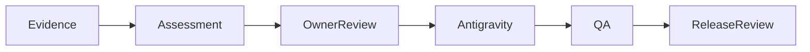

# Orchestration
The owner selects opportunities and approves production and releases. Studio OS discovers and evaluates opportunities, orchestrates work, validates outputs and measures results. Antigravity produces commercial content and product files.

The first technical pilot is the Mobile Detailing Planner; it is an unvalidated hypothesis, not an approved production order.
